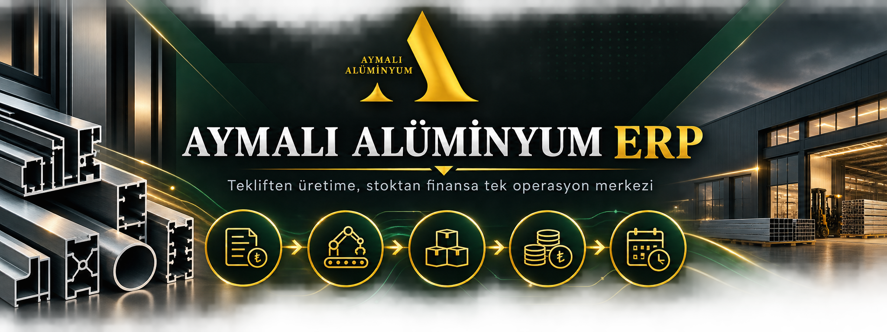

<h1 align="center">Aymalı Alüminyum ERP</h1>

  <strong>Tekliften üretime, stoktan finansa günlük operasyonları tek merkezde yöneten iş uygulaması.</strong>

  
  
  
  

## 30 saniyede ürün

| | |
| --- | --- |
| **Problem** | Teklif, üretim, stok ve finans bilgisinin farklı dosyalara dağılması. |
| **Çözüm** | İşletmenin ana operasyonlarını birbirine bağlı kayıtlarla tek masaüstü akışında toplamak. |
| **Kullanım modeli** | Yerel ağda, aynı operasyon verisi üzerinde çok kullanıcılı çalışma. |
| **İzlenebilirlik** | İşlem geçmişi, kontrol listeleri, mutabakat ve düzenli yedekleme. |

## Operasyon akışı

~~~mermaid
flowchart LR
    A[Müşteri ve teklif] --> B[İş emri ve planlama]
    B --> C[Stok ve satın alma]
    C --> D[Üretim ve teslim]
    D --> E[Tahsilat ve cari]
    E --> F[Raporlama ve mutabakat]
~~~

## Başlıca yetenekler

- Müşteri, iş emri, ekip ve görev yönetimi
- Teklif revizyonu, indirim ve KDV hesaplama
- Stok hareketi, rezervasyon ve satın alma siparişleri
- Tahsilat, ödeme, taksit ve cari hesap takibi
- Kasa, banka, virman ve mutabakat işlemleri
- Personel giderleri ve yetki kontrollü ekranlar
- Sürükle-bırak takvim, planlama ve kontrol listeleri
- İşlem geçmişi, günlük yedek ve tam yedekten geri yükleme

## Veri yaklaşımı

Operasyon verileri işletmenin kendi bilgisayarında ve yerel ağında tutulur. Rol ayrımı, işlem geçmişi ve yedekleme akışları günlük kullanımın sürekliliğini destekler.

## Kullanım ve iletişim

Kurulum, lisanslama veya ürün hakkında bilgi almak için Aymalı Alüminyum ile iletişime geçebilirsiniz.

© 2026 Aymalı Alüminyum. Tüm hakları saklıdır.
